# Enterprise Human Resource Management System (HRMS)

[](https://dotnet.microsoft.com/)
[](https://react.dev/)
[](https://www.microsoft.com/sql-server/)
[](https://vitejs.dev/)
[](https://getbootstrap.com/)
[](https://jwt.io/)
[](LICENSE)

An enterprise-grade, full-stack **Human Resource Management System (HRMS)** built with modern web technologies, domain-driven clean architecture, high-performance database indexing, and strict role-based access control (RBAC). 

Engineered to streamline multi-branch and multi-department workforce operations, including employee lifecycle tracking, biometric-style attendance tracking, roster scheduling, automated payroll calculation, expense claim workflows, asset inventory, applicant tracking (ATS), and employee self-service (ESS).

---

## Table of Contents
- [1. Executive Summary & Capabilities](#1-executive-summary--capabilities)
- [2. UI Showcase & Module Walkthrough](#2-ui-showcase--module-walkthrough)
  - [2.1 Authentication & Multi-Role Login](#21-authentication--multi-role-login)
  - [2.2 Executive Workforce Dashboard](#22-executive-workforce-dashboard)
  - [2.3 Employee Lifecycle & Directory Management](#23-employee-lifecycle--directory-management)
  - [2.4 Time & Attendance Tracking](#24-time--attendance-tracking)
  - [2.5 Automated Payroll & Compensation Processing](#25-automated-payroll--compensation-processing)
  - [2.6 Leave & Absence Administration](#26-leave--absence-administration)
  - [2.7 Applicant Tracking System (ATS) & Pipeline](#27-applicant-tracking-system-ats--pipeline)
  - [2.8 IT & Physical Asset Lifecycle Management](#28-it--physical-asset-lifecycle-management)
  - [2.9 Shift Scheduling & Roster Planner](#29-shift-scheduling--roster-planner)
  - [2.10 Employee Self-Service (ESS) Portal](#210-employee-self-service-ess-portal)
- [3. Architecture & Technology Stack](#3-architecture--technology-stack)
- [4. Repository & Directory Structure](#4-repository--directory-structure)
- [5. Getting Started & Installation Guide](#5-getting-started--installation-guide)
  - [Prerequisites](#prerequisites)
  - [Database Setup](#1-database-setup)
  - [Backend Configuration & Execution](#2-backend-configuration--execution)
  - [Frontend Client Setup & Execution](#3-frontend-client-setup--execution)
- [6. Default Test Accounts & Roles](#6-default-test-accounts--roles)
- [7. API Specifications & Health Checks](#7-api-specifications--health-checks)
- [8. Reliability, Performance & Security Highlights](#8-reliability-performance--security-highlights)
- [9. Contributing & License](#9-contributing--license)

---

## 1. Executive Summary & Capabilities

* **Multi-Tier Role Access:** Strict segregation of duties across `Super Admin`, `HR Admin`, `Manager`, and `Employee` personas with endpoint-level authorization guards.
* **Master Data Architecture:** Multi-company, branch, department, and designation management with automatic referential integrity.
* **Employee Lifecycle Management:** Comprehensive record keeping from onboarding documentation and asset allocation to resignation management and full-and-final (FnF) settlements.
* **Time & Attendance:** Biometric check-in/out logging, automatic late-arrival minute computation, shift rosters, and attendance regularizations.
* **Payroll & Tax Processing:** Base salary structures, allowances, deductions, PF, ESI, professional tax, monthly batch calculation, and one-click mark-as-paid workflows.
* **Talent Acquisition (ATS):** End-to-end recruitment lifecycle with job vacancy postings, candidate pipeline stages (Applied, Screening, Interview, Offered, Hired), and interview round feedback.
* **Performance Management (PMS):** OKR and goal tracking, employee self-evaluations, manager appraisals, and performance review cycles.
* **Asset Allocation & Governance:** Hardware/software inventory with lifecycle state tracking, serial number cataloging, and return workflows.
* **Expense Reimbursement:** Multi-category claim submissions with receipt uploads, expense limits, and manager approval queues.

---

## 2. UI Showcase & Module Walkthrough

### 2.1 Authentication & Multi-Role Login
Secure JWT-based authentication system with BCrypt password hashing, sliding token storage, auto-logout on session expiration, and role-tailored route protection.

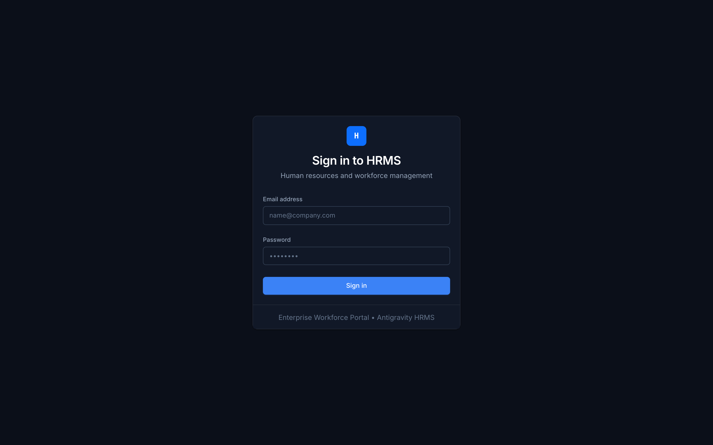

---

### 2.2 Executive Workforce Dashboard
Provides immediate situational awareness for HR leaders and executives with live workforce headcounts, attendance breakdowns, pending approval alerts, and monthly payroll summaries.

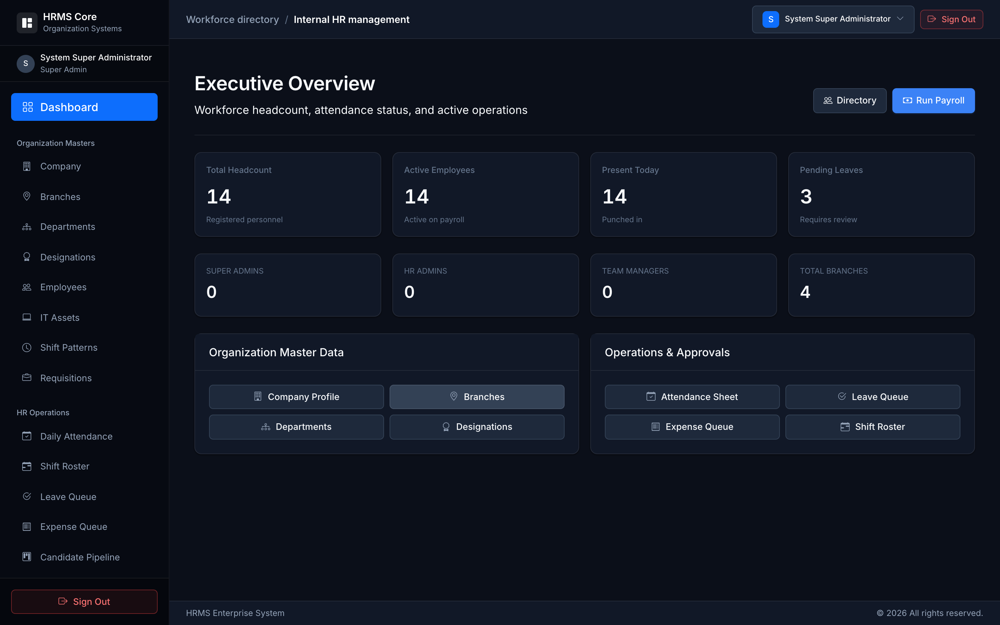

---

### 2.3 Employee Lifecycle & Directory Management
Complete digital personnel filing system featuring paginated tables, search and department filtering, dynamic status indicators, personal/bank detail management, and role assignment.

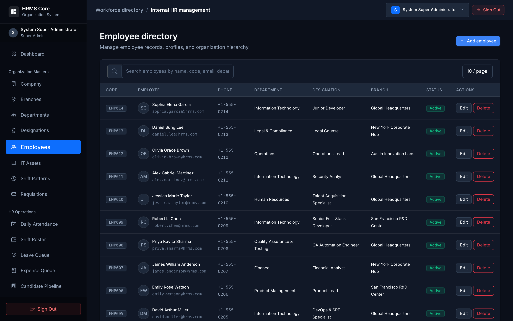

---

### 2.4 Time & Attendance Tracking
Daily workforce attendance monitor capturing check-in, check-out, working hours, and automated late minutes across all company branches.

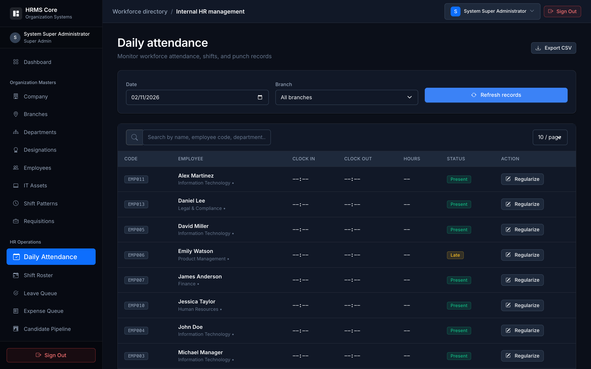

---

### 2.5 Automated Payroll & Compensation Processing
Enterprise payroll engine that compiles gross salaries, allowances, statutory deductions (PF, ESI, PT), generates payslips, and executes atomic monthly payroll runs.

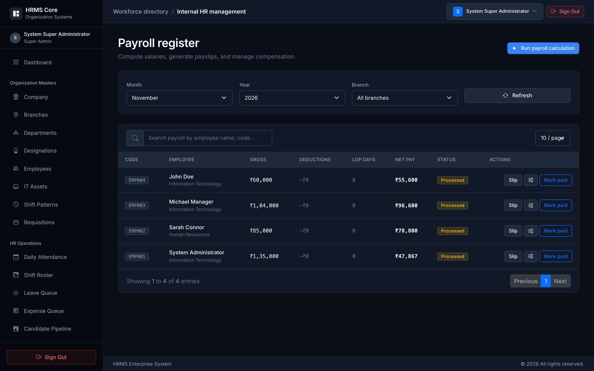

---

### 2.6 Leave & Absence Administration
Configurable leave entitlement policies (Annual, Casual, Sick, Maternity), employee balance ledgers, and multi-level approval workflows with audit notes.

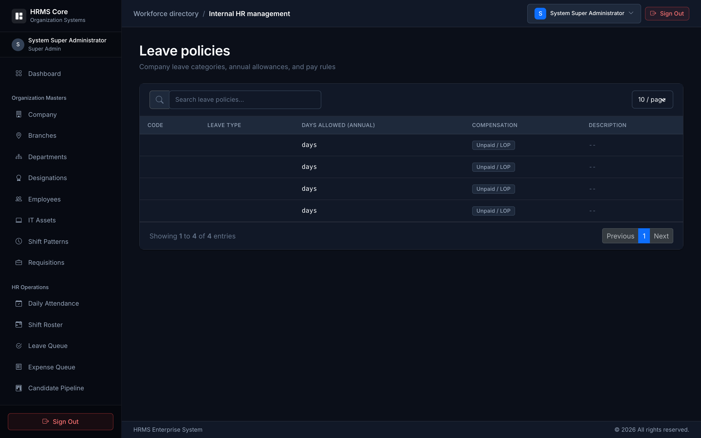

---

### 2.7 Applicant Tracking System (ATS) & Pipeline
Visual recruitment workflow allowing talent acquisition teams to post open positions, evaluate incoming candidates, and transition applicants through interview rounds.

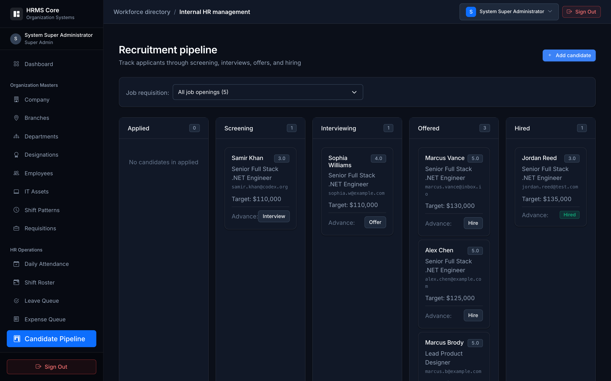

---

### 2.8 IT & Physical Asset Lifecycle Management
Tracks company hardware (laptops, monitors, phones) and software licenses, maintaining detailed assignment histories linked to active employees.

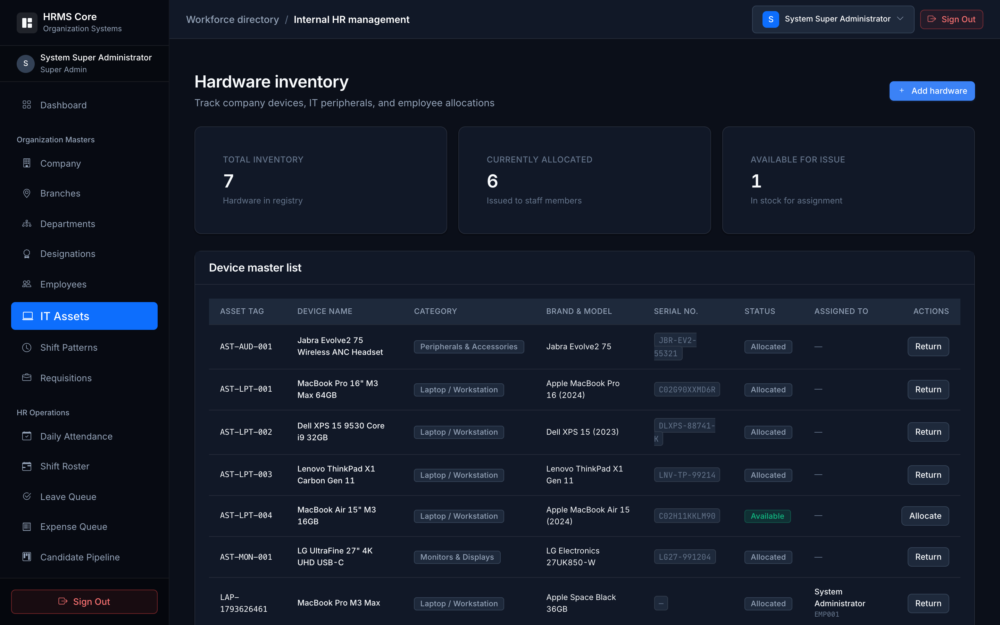

---

### 2.9 Shift Scheduling & Roster Planner
Visual operational roster allowing managers to assign day, evening, and night shifts across distributed teams with branch-level filtering.

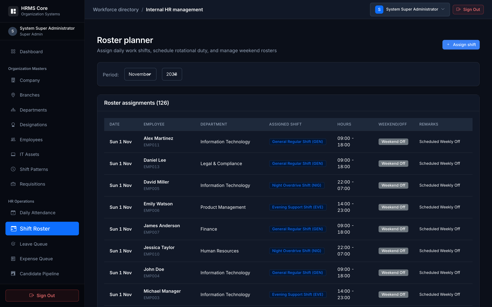

---

### 2.10 Employee Self-Service (ESS) Portal
Empowers individual employees to clock in/out, view personal attendance history, request leave, review payslips, and file expense claims from a single portal.

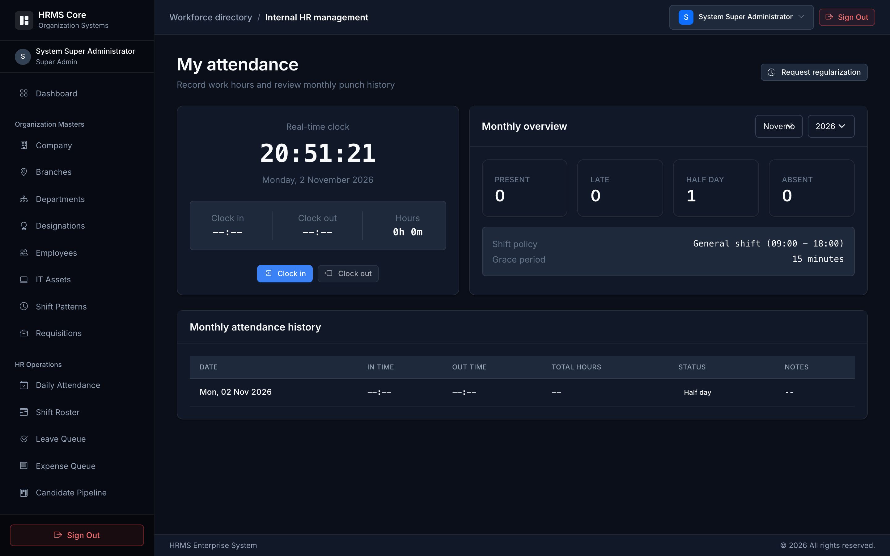

---

## 3. Architecture & Technology Stack

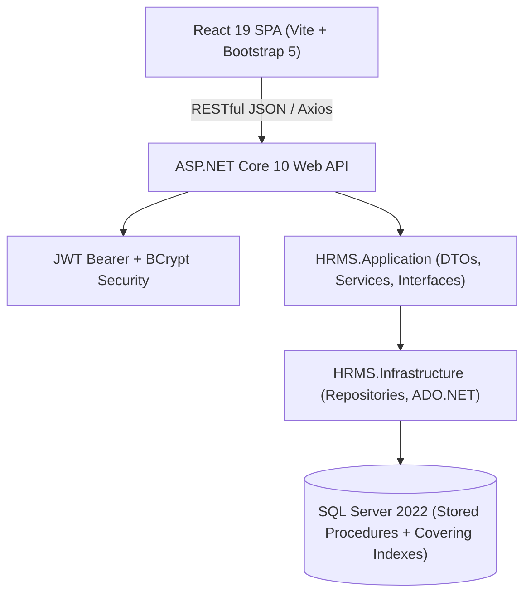

### Technology Matrix

| Layer | Technology | Key Capabilities |
| :--- | :--- | :--- |
| **Frontend** | React 19, Vite 8, React Router v7 | Fast HMR, component isolation, React Error Boundary, responsive dark-mode UI |
| **Styling** | Bootstrap 5.3 + Bootstrap Icons | Accessible styling, responsive layout grid, custom dark-mode CSS variables |
| **API Server** | ASP.NET Core 10, C# | Clean Architecture, dependency injection, async pipeline, centralized exception middleware |
| **Security** | JWT (JSON Web Tokens), BCrypt.Net | Cryptographically signed bearer tokens, SHA-512 salted password hashing, RBAC |
| **Database** | Microsoft SQL Server 2022 | Stored procedure data access, atomic transactions, 12 composite nonclustered indexes |
| **Observability**| ASP.NET Core Health Checks | Dedicated `/health` probe for container orchestrators and uptime monitoring |

---

## 4. Repository & Directory Structure

```plaintext
HRMS/
├── database.sql                     # Complete primary schema, stored procedures & indexes
├── credentials.md                   # Complete test login directory (git-ignored)
├── improvemts.md                    # Architecture and code quality roadmap
├── docs/
│   └── screenshots/                 # High-resolution module screenshots for documentation
├── HRMS_CLIENT/                     # Frontend Single Page Application
│   ├── src/
│   │   ├── components/              # Layout, Navbar, Sidebar, ErrorBoundary, Tables
│   │   ├── context/                 # AuthContext & global session state
│   │   ├── pages/                   # Auth, Dashboard, Employee, Payroll, ATS, Assets, etc.
│   │   ├── routes/                  # ProtectedRoute, RoleRoute, and router tree
│   │   └── services/                # Axios instance & domain API wrappers
│   ├── vite.config.js
│   └── package.json
└── HRMS_SERVER/                     # Backend .NET 10 Solution
    ├── HRMS.slnx
    ├── Database/                    # Enterprise migration scripts & procedures
    ├── HRMS.Domain/                 # Core domain entities & models
    ├── HRMS.Application/            # Service contracts, DTOs & business services
    ├── HRMS.Infrastructure/         # ADO.NET repositories, SQL data mappers
    └── HRMS.API/                    # Controllers, Program.cs, middleware & health checks
```

---

## 5. Getting Started & Installation Guide

### Prerequisites
Before running the application, ensure you have the following installed on your machine:
* **[.NET 10.0 SDK](https://dotnet.microsoft.com/download)**
* **[Node.js (v18.x or later)](https://nodejs.org/)** and **npm**
* **[Microsoft SQL Server 2019/2022](https://www.microsoft.com/sql-server/)** (Local instance or Docker container)
* **[Git](https://git-scm.com/)**

---

### 1. Database Setup

1. Start your local Microsoft SQL Server instance (default port: `1433`).
2. Run the master migration scripts to create tables, seed data, and generate stored procedures:
   ```bash
   # Using sqlcmd CLI
   sqlcmd -S localhost -U SA -P 'Password@123' -C -i database.sql
   sqlcmd -S localhost -U SA -P 'Password@123' -C -d HRMS -i HRMS_SERVER/Database/HRMS_Phase9_to_15_Features.sql
   ```
   *(Alternatively, execute the scripts directly in SQL Server Management Studio or Azure Data Studio).*

---

### 2. Backend Configuration & Execution

1. Navigate to the backend API directory:
   ```bash
   cd HRMS_SERVER/HRMS.API
   ```
2. Verify or update connection string in `appsettings.json`:
   ```json
   "ConnectionStrings": {
     "DBCS": "Server=localhost,1433;Database=HRMS;User Id=SA;Password=Password@123;TrustServerCertificate=True;Encrypt=False;"
   }
   ```
3. Restore dependencies, build, and run the server:
   ```bash
   dotnet restore
   dotnet run --launch-profile http
   ```
4. The API will initialize on `http://localhost:5153`. Verify the server health:
   ```bash
   curl -i http://localhost:5153/health
   # Returns: HTTP/1.1 200 OK -> "Healthy"
   ```

---

### 3. Frontend Client Setup & Execution

1. In a new terminal, navigate to the frontend directory:
   ```bash
   cd HRMS_CLIENT
   ```
2. Ensure the API endpoint in `.env` points to your backend:
   ```env
   VITE_API_BASE_URL=http://localhost:5153/api/
   ```
3. Install dependencies and start the Vite dev server:
   ```bash
   npm install
   npm run dev
   ```
4. Open your browser and navigate to:
   ```
   http://localhost:5173
   ```

---

## 6. Default Test Accounts & Roles

The system comes pre-seeded with 14 active accounts across all organizational departments. All accounts share the same development password:

> **Default Password for All Accounts:** `Password@123`

| Role | Representative User | Email | Purpose & Access Scope |
| :--- | :--- | :--- | :--- |
| **Super Admin** | System Administrator | `admin@hrms.com` | Unrestricted access across all company configurations, masters, audits, and settings |
| **HR Admin** | Sarah Connor | `hr@hrms.com` | Employee onboarding/exits, leave approvals, payroll processing, candidate hiring |
| **Manager** | Michael Manager | `manager@hrms.com` | Team attendance, shift roster scheduling, leave/expense approvals, employee appraisals |
| **Employee** | John Doe | `employee@hrms.com` | Self-Service (clock-in/out, view personal payslips, submit leave & expense claims) |

*For the complete 14-employee directory with codes and designations, refer to [credentials.md](credentials.md).*

---

## 7. API Specifications & Health Checks

The ASP.NET Core backend exposes RESTful endpoints grouped by business domain:

| Domain | Controller | Representative Endpoints | Authorization |
| :--- | :--- | :--- | :--- |
| **System** | `Health` | `GET /health` | Anonymous |
| **Auth** | `AuthController` | `POST /api/Auth/Login`, `GET /api/Auth/Profile` | Public / Bearer |
| **Employees** | `EmployeeController` | `GET /api/Employee/GetAll`, `POST /api/Employee/CreateEmployee`, `DELETE /api/Employee/{id}` | Admin / HR Admin |
| **Attendance**| `AttendanceController` | `POST /api/Attendance/CheckIn`, `POST /api/Attendance/CheckOut`, `GET /api/Attendance/Daily` | Authenticated |
| **Leave** | `LeaveController` | `POST /api/Leave/Apply`, `POST /api/Leave/Approve`, `GET /api/Leave/MyHistory` | Role-based |
| **Payroll** | `PayrollController` | `POST /api/Payroll/ProcessMonthly`, `POST /api/Payroll/MarkPaid`, `GET /api/Payroll/Payslip/{id}` | Super Admin / HR Admin |
| **Recruitment**| `ATSController` | `GET /api/ATS/Jobs`, `POST /api/ATS/Apply`, `PUT /api/ATS/Stage` | HR Admin / Manager |
| **Assets** | `AssetController` | `GET /api/Asset/Inventory`, `POST /api/Asset/Allocate`, `POST /api/Asset/Return` | Super Admin / HR Admin |
| **Expenses** | `ExpenseController` | `POST /api/Expense/Submit`, `POST /api/Expense/Approve`, `GET /api/Expense/Pending` | Manager / HR Admin |
| **Rosters** | `ShiftController` | `GET /api/Shift/Roster`, `POST /api/Shift/Assign` | Manager / HR Admin |

---

## 8. Reliability, Performance & Security Highlights

* **12 Composite Nonclustered Indexes:** Covers foreign keys and high-frequency filter paths (`AttendanceDate`, `EmployeeId`, `PayrollYear`, `RosterDate`), replacing full table scans with high-speed index seeks.
* **Atomic Stored Procedure Transactions:** Multi-row mutations in stored procedures (e.g. `sp_Payroll_Operations`) enforce explicit `BEGIN TRY ... BEGIN TRANSACTION ... COMMIT ... END TRY ... BEGIN CATCH ... ROLLBACK`, preventing partial writes and logging failures to `SPErrorlog`.
* **Global React Error Boundary:** React components are wrapped in a resilient `<ErrorBoundary>` to isolate runtime render failures and display friendly recovery dialogs without crashing the entire single-page application.
* **Soft 401 Interceptors:** Expired JWT sessions broadcast custom events (`hrms:unauthorized`) to reset authentication state cleanly through React Router instead of triggering abrupt full-page window reloads.
* **Health Check Probe:** Built-in `/health` endpoint responds with HTTP 200 OK to allow seamless load balancer and container health monitoring.

---

## 9. Contributing & License

Contributions, issue reports, and feature proposals are welcome! Please follow these steps:
1. Fork the repository.
2. Create your feature branch (`git checkout -b feature/NewCapability`).
3. Commit your changes (`git commit -m 'feat: add new capability'`).
4. Push to the branch (`git push origin feature/NewCapability`).
5. Open a Pull Request.

### License
This project is licensed under the **MIT License**.
